<picture>
  <source media="(prefers-color-scheme: dark)" srcset="assets/banner-dark.svg">
  
</picture>

I build LLM applications, retrieval and reranking pipelines, MLOps systems and real-time IoT data pipelines, and I like owning the whole path from raw data to a deployed, monitored service. I'm doing an M.Sc. in Data and Knowledge Engineering at Otto von Guericke University Magdeburg, and I spent 15 months as a software engineer at Swaja Robotics, building data pipelines for 100+ connected devices.

**Open to working-student (Werkstudent) roles in AI, data, cloud and full-stack engineering, starting now.**

[Portfolio](https://veer-pratap-singh-portfolio.vercel.app) · [LinkedIn](https://www.linkedin.com/in/veer-pratap-singh07/) · [Email](mailto:veerrpratapsingh@gmail.com) · [X](https://x.com/veersingh0707)

### Selected work

<table>
<tr>
<td width="50%" valign="top">

**[AFS In-line Spectroscopy Assistant](https://github.com/Adarshpandey2003/afs_national_ai_hackathon)** 
National AI Hackathon 2026 · team project

Four LangGraph agents (clarifier, ReAct researcher, writer, critic) turn an industrial customer's enquiry into a first technical assessment. Hybrid FAISS + BM25 retrieval; the critic checks every citation and number against its source before the report goes out.

Python · LangGraph · DeepSeek · FastAPI · React · [live demo](https://afsnationalaihackathon.vercel.app)

</td>
<td width="50%" valign="top">

**[Fairness in LLM-based learning recommendation](https://github.com/veer-pratapsingh/HCAI-fairness-recsys)** 
Human-Centred AI project · OVGU 2026

Retrieve-then-rerank on 10.6M OULAD clickstream events: collaborative filtering retrieves 50 candidates, LLMs rerank the top 10, benchmarked against ALS and SASRec over 5 seeds. Post-hoc reranking cut the equal-opportunity gap by 10% at a 13% recall cost.

Python · PyTorch · Gemini, Mistral, DeepSeek, GPT-4o-mini · pytest

</td>
</tr>
<tr>
<td width="50%" valign="top">

**Airline satisfaction MLOps pipeline** 
MLOps team project · OVGU 2026 · code on university GitLab

Nine-step pipeline on ~130k records behind a four-stage GitLab CI/CD: Feast feature store, Optuna-tuned models tracked in MLflow, a ROC-AUC gate for champion and challenger promotion, FastAPI serving with an 80/20 traffic split, Grafana monitoring.

Python · Feast · MLflow · Docker · FastAPI · Grafana

</td>
<td width="50%" valign="top">

**[Focus Guardian](https://github.com/veer-pratapsingh/focus-guardian)** 
Windows desktop app · v0.2

A local-first focus app: you choose the apps and websites a session needs, and anything else is interrupted with a full-screen reminder of what you meant to finish. Companion Chrome extension, tray mode, no account, no cloud.

JavaScript · Electron · Chrome extension

</td>
</tr>
<tr>
<td width="50%" valign="top">

**[md forge](https://github.com/veer-pratapsingh/md-forge)** 
Web tool

Converts PDF, Word, Excel, PowerPoint, HTML and more to clean Markdown in the browser, and shows how many tokens and dollars that saves before a file goes to an LLM. Nothing is uploaded.

JavaScript · pdf.js · SheetJS · gpt-tokenizer · [live](https://md-forge-teal.vercel.app)

</td>
<td width="50%" valign="top">

**[Sign-language detection](https://github.com/veer-pratapsingh/Final-Year-Project-Sign-Language-Detection)** 
B.Tech research · published

Real-time sign-language and hand-gesture recognition with deep learning and OpenCV, reaching 99.7% accuracy on 34,000+ images.

Python · OpenCV · deep learning

</td>
</tr>
</table>

Also: websites for hotels, bars and small businesses, built with Inderpreet Singh ([studio portfolio](https://veer-pratap-singh-portfolio.vercel.app)), and a Unity 6 training simulator of a biogas plant, built with chemical-engineering students.

### Experience

**Software Engineer, Swaja Robotics** · Jul 2024 – Sep 2025 
Real-time MQTT pipelines in Python and SQL for 100+ connected devices, a home-automation platform on Raspberry Pi (Python, Electron, REST APIs, PostgreSQL), and Power BI and Tableau dashboards that improved monitoring efficiency by 30%.

**Technology Intern, UMUN Tech** · 2023–24 
Client websites and web apps deployed on Azure, and a real-time library space booking system, from stakeholder interviews to launch.

**Intern, IIT Kanpur** · 2023 
An interactive virtual fluid-chemistry lab with 15+ animated experiments, used remotely by 500+ students.

### Toolbox

- **AI & LLM:** LangChain, LangGraph, FAISS, LLM APIs (OpenAI, Gemini, DeepSeek, Mistral, NVIDIA NIM), retrieve-then-rerank, prompt engineering, SASRec, NLP, computer vision
- **Machine learning:** PyTorch, scikit-learn, TensorFlow/Keras, XGBoost, LightGBM, Optuna, statistical testing
- **MLOps:** MLflow, Feast, Docker, GitLab CI/CD, FastAPI, Prometheus, Grafana
- **Data & cloud:** SQL, PostgreSQL, Supabase, ETL/ELT, MQTT, AWS, Azure, Power BI, Tableau
- **Languages & web:** Python, TypeScript, JavaScript, C/C++, C#, React, Next.js, Node.js, Express, Electron

### Education & certifications

**M.Sc. Data and Knowledge Engineering**, Otto von Guericke University Magdeburg · since 2025 
**B.Tech Computer Science and Engineering (AI & ML)**, AKTU, MIET Meerut · 2020–24 · First Division with Distinction

AWS Certified AI Practitioner · AWS Certified Cloud Practitioner · Microsoft Power BI Data Analyst Associate (PL-300) · Azure Fundamentals (AZ-900) · Azure AI Fundamentals (AI-900) · Azure Data Fundamentals (DP-900)

### Beyond code

- **Founder and President, Intellia AI & ML Society** (2022–24): built it to 60+ members; ran 5+ hackathons and 10+ hands-on trainings reaching 1,000+ students.
- **Cloud Computing Head, Microsoft Learn Student Ambassadors** (2023–24): trained 150+ students in Azure fundamentals through 10+ workshops.
- **Team Lead, talk2move** (2025–26): promoted from fundraiser after three months; led a team raising funds for Plan International, SOS-Kinderdörfer, CARE and WWF alongside my studies.
- **Awards:** Gold Medal in AI (Wipro TalentNext) · 1st place, Cisco ThingQbator competition
- **Languages:** English (C1) · German (A2, improving) · Hindi (native)
